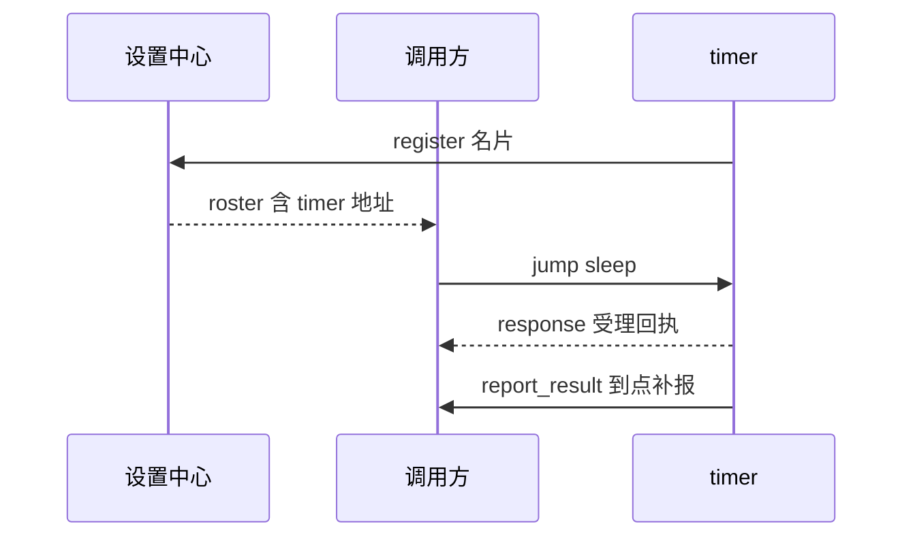

# 03｜注册、发现与配置：通讯录知道什么，服务自己决定什么

<!-- attribution:start -->
> 由 **xml-nya-meow** 编写与整理，最初用于个人学习与知识积累。如有疏漏、错误或不清楚之处，欢迎指出。
>
> 本页围绕 [SUMP 主项目](https://github.com/NouSart/sump) 编写，为个人学习资料；项目源码与引用内容保留原作者及贡献者归属。
<!-- attribution:end -->

**对应版本：**2026-10-26，提交 `149451dbf9ec953006da7c1926c336cfd9da0633`。

**阅读依据：**本轮静态阅读 `service` 与 `settings-center`。以下步骤是源码模拟和学习练习，没有实际修改正在运行的配置。

## 1. 这一章学会什么

你将理解服务怎样找到彼此、为什么“保存成功”不等于“已经生效”，以及配置错误和业务失败分别该往哪里反馈。

核心问题只有一个：**谁掌握哪份事实，谁有权决定它？**

## 2. 设置中心像通讯录管理员

新工作室开门后，把名字、地址和服务项目交给管理员。管理员把新通讯录发给大家。

如果文件工作室需要计时器，它按通讯录找到计时工作室，直接联系对方。管理员不需要替每份委托跑腿。

| 项目词语 | 白话含义 | 对应源码 |
|---|---|---|
| register，注册 | 报到并提交名片 | `RegisterPayload` |
| roster，名册 | 当前可发现服务的通讯录 | `RosterPayload` |
| provides，能力声明 | 服务自述有哪些动作 | `Provide` |
| heartbeat，心跳 | 定期报“我还在” | `HeartbeatPayload` |
| revision，修订号 | 通讯录发生变化后的编号 | `RosterPayload.Revision` |

名片里的 `input` 和 `output` 是人读的说明文字，不是严格的数据校验程序。即使别人能看到工具说明，服务仍要检查实际输入。

`tool` 表示是否愿意作为模型工具，`async` 表示是否先回执后补报，`batchable` 表示是否允许批处理调用。这三个开关不互相替代。

## 3. 一个服务怎样进入通讯录

以下以 timer 为例，是教学模拟。

1. timer 根据启动参数准备自身名称、监听地址和中心地址。
2. 先打开自己的 WS 监听入口，再连接设置中心。
3. 发送 register，包含 `name`、`addr`、`provides`、`settings`、`heartbeat_ms` 等名片字段。
4. 中心记录名片，并回复包含 `services` 和 `revision` 的当前名册。
5. timer 把名册保存在自己的内存中，以后收到 roster 事件再更新。
6. timer 开始周期性发心跳，并获取自身配置。

首次注册失败时，`Service.Start` 返回错误并关闭刚打开的监听。这个实现不会把“自己已监听但没注册上”当成完整启动成功。

运行中中心连接断开，骨架会重连并重新注册；重试间隔逐渐增加，最高 30 秒。**重连不是重启进程**：程序本身崩溃以后，这个循环也就不存在了。

## 4. 离线不是只看连接有没有断

骨架默认约每 15 秒发送一次心跳。中心按服务声明的间隔判断：超过两倍间隔没收到，再由扫描任务将它移出名册。

所以默认情况下“约 30 秒后可能被判断离线”比“断开立刻离线”准确；实际时刻还取决于扫描间隔。

主动关闭时，服务尽力发送 `status:"bye"`。中心收到后立即摘除名片，不必等心跳超时。

重连时如果名片内容没变，中心只更新连接和心跳记录，不会无意义地增加 revision、广播同样的名册。

**快照**是某一时刻的一整份状态副本。名册快照是发现信息，不保证下一毫秒目标仍在线，也不保证它有足够容量接受你的请求。

## 5. 找到服务后，业务请求怎么走

`Service.Resolve("timer")` 从本地名册查地址；`Service.Call(...)` 按这个地址直连目标。`to:"self"` 是显式访问自身的特殊写法。



这张图只讲业务路径，省略了各服务自己的注册、心跳和其他消息。

设置中心负责发现与配置，不是承接所有业务数据的总转发器。中心短暂断线后，已有服务可能仍持有可用名册；不能据此保证所有功能完全不受影响。

## 6. 三类设置，保存位置不同

**配置**是影响程序行为的参数。例如 timer 同时允许多少个计时、Reasoner 使用哪个模型地址。

| 类别 | 声明方法 | 谁保存实际资料 | 用户看到什么 |
|---|---|---|---|
| 普通项 | `HandleSetting` | 中心保存覆盖值；服务保存运行中的生效值 | 值、默认值、是否覆盖等 |
| 秘密项 | `HandleSecret` | 使用该秘密的服务本地保存 | 是否已有值，不回显秘密 |
| 只读项 | `HandleReadOnly` | 来源是该服务的启动参数 | 当前启动值，需要重启才能改 |

**覆盖值**是用户后来填写、用于替代默认值的配置。重置普通项就是清掉覆盖值，让它回到声明的默认值。

秘密项不是完全不经过中心：用户提交那一次，中心会短暂转发它，但不把秘密值放进自己的持久配置或查询结果。

服务默认把秘密项写入本地 `data/<服务名>-secret.json`；这是明文配置文件，不是加密保险箱。`SecretFile:"-"` 可以选择只放内存。

源码用临时文件再改名的方式降低写到一半的风险。**原子替换**解决文件完整性问题，不自动解决秘密泄露、备份或 Windows 文件权限配置。

## 7. 模拟：把计时上限改为 60000 毫秒

**这是教学模拟，不会真的修改你的 timer。**假设已有 timer 注册，用户希望最长计时变成 1 分钟。

第一步，发给设置中心的动作是 `set_setting`，输入如下：

```json
{"service":"timer","key":"max_ms","value":"60000"}
```

注意 value 是字符串。中心保存普通覆盖值，再把配置转换成 `configure` 发给 timer；不是直接伸进 timer 内存修改变量。

第二步，timer 的设置回调把字符串转成整数，检查最小时长和最大上限。通过后更新本服务的计时限制。

第三步，timer 回复应用结果；中心广播 `settings` 事件，让门户显示是否真正生效。

| 你可能看到的状态 | 实际意味着什么 |
|---|---|
| set_setting 已返回成功 | 中心已经受理；下发可能还在进行 |
| configure 成功 | 服务已确认应用这一次值 |
| configure 被拒绝 | 服务不接受它，不能说已经改变行为 |
| 未送达 | 目标未收到或未能确认，需查看后续状态 |

现在把 value 换成 `"abc"`。中心仍可能先保存这个普通覆盖值，随后 timer 拒绝不能转换为整数的输入；原来的计时上限仍在使用。

这就解释了为什么“中心期望值”和“服务实际值”要分开显示。用户需要纠正或重置无效覆盖值，而不是反复点保存就假设成功。

## 8. 服务自己改变设置后怎样告诉别人

某些服务会规范化或主动调整运行值。此时调用 `AnnounceSetting`，向中心发送 `report_setting`。

**report_setting 是报告事实，不是再次请求修改。**它更新中心记录的 `actual` 等信息，不覆写用户保存的普通覆盖值。

`seq` 是递增序号，帮助中心识别旧报告。普通实际值报告中，比已知序号更小的非零序号会被忽略，避免旧状态把新状态盖掉。

报告通过后台调用发送，没有持久补发队列。它是当前状态展示机制，不是每一次变化都绝不丢失的审计账本。

## 9. 什么是业务错误，什么是服务故障

“读取的文件不存在”“命令被审批拒绝”“计时参数不合法”是这次业务无法完成。应把原因交回调用方，让它决定下一步。

“本地配置损坏”“后台通信异常”等问题属于服务运行层面的异常，需要日志和必要的中心反馈；但能否上报成功还取决于中心连接是否存在。

`Service.Report(kind,message)` 提供集中报错通道。它有退避节流，中心断线时也不持久排队。因此“有 Report 方法”不代表每条错误必达。

**本版实现还有一个要看清的边界：**`Fire` 在后台调用失败后会集中上报；`Call` 返回的失败可以包含远端业务拒绝。所以它并没有自动、完美地将所有业务错误和服务故障分类隔离。

写新服务时应明确哪些处理函数返回业务结果，哪些异常主动调用 Report。配置回调也应先校验再改变状态：骨架不会替任意回调撤销已经发生的外部副作用。

## 10. 动手练习：不用启动程序，也能核对一条配置

1. 打开 `timer/server/server.go`，搜索 `HandleSetting("max_ms"`。
2. 找到字符串转换为整数的位置，再找拒绝非法输入的 `return`。
3. 往下找到 `HandleReadOnly("addr"`，判断监听地址能不能用普通配置页面直接热改。
4. 打开 `settings-center/tests/configure_test.go`，找到 `TestConfigurePushRejected`。
5. 对照测试注释，写下中心“受理”和服务“生效”为什么是两个结果。

**应有结果：**`abc` 不能通过 timer 的整数校验；`addr` 是只读启动项；中心可以受理一个随后被服务拒绝的普通覆盖值。

若只找到 `max_ms` 的说明文字而没找到校验代码，要继续搜索 `HandleSetting`，不能把说明当成实际执行逻辑。

进阶时可在测试代码中跟踪 `TestSettingConfigure`：它使用临时中心替身，依次检查正常应用、非法值拒绝和未知键拒绝。本章没有运行它，阅读测试也不等于测试已通过。

## 11. 固定版本源码入口

- [注册、重连、调用与退出](https://github.com/NouSart/sump/blob/149451dbf9ec953006da7c1926c336cfd9da0633/service/service.go)
- [名册、心跳离线与修订号](https://github.com/NouSart/sump/blob/149451dbf9ec953006da7c1926c336cfd9da0633/settings-center/hub/hub.go)
- [中心受理、下发和回传](https://github.com/NouSart/sump/blob/149451dbf9ec953006da7c1926c336cfd9da0633/settings-center/server/server.go)
- [普通覆盖值与实际值](https://github.com/NouSart/sump/blob/149451dbf9ec953006da7c1926c336cfd9da0633/settings-center/hub/settings.go)
- [设置骨架](https://github.com/NouSart/sump/blob/149451dbf9ec953006da7c1926c336cfd9da0633/service/settings.go)、[秘密文件](https://github.com/NouSart/sump/blob/149451dbf9ec953006da7c1926c336cfd9da0633/service/secrets.go)、[集中报错](https://github.com/NouSart/sump/blob/149451dbf9ec953006da7c1926c336cfd9da0633/service/report.go)
- [timer 设置实现](https://github.com/NouSart/sump/blob/149451dbf9ec953006da7c1926c336cfd9da0633/timer/server/server.go)、[中心下发测试](https://github.com/NouSart/sump/blob/149451dbf9ec953006da7c1926c336cfd9da0633/settings-center/tests/configure_test.go)、[服务应用测试](https://github.com/NouSart/sump/blob/149451dbf9ec953006da7c1926c336cfd9da0633/service/tests/settings_test.go)

<!-- attribution-footer:start -->
---

**编写与整理：xml-nya-meow** · 原用途：个人向知识库。

如有不足，欢迎提出勘误或改进建议：[反馈入口](https://github.com/xml-nya-meow/sump-knowledgebase/issues)。

[个人知识库](https://github.com/xml-nya-meow/sump-knowledgebase) · [SUMP 主项目](https://github.com/NouSart/sump)

阅读时请核对本页对应的源码版本；本文不代表 SUMP 官方文档。转载或同步时请保留编写者、来源和适用的许可说明。

内容责任与立场说明：若知识库内容存在问题，由对应编者负责核查与修订；本页内容不代表其他团队成员、组织成员或组织的意见与观点。
<!-- attribution-footer:end -->
