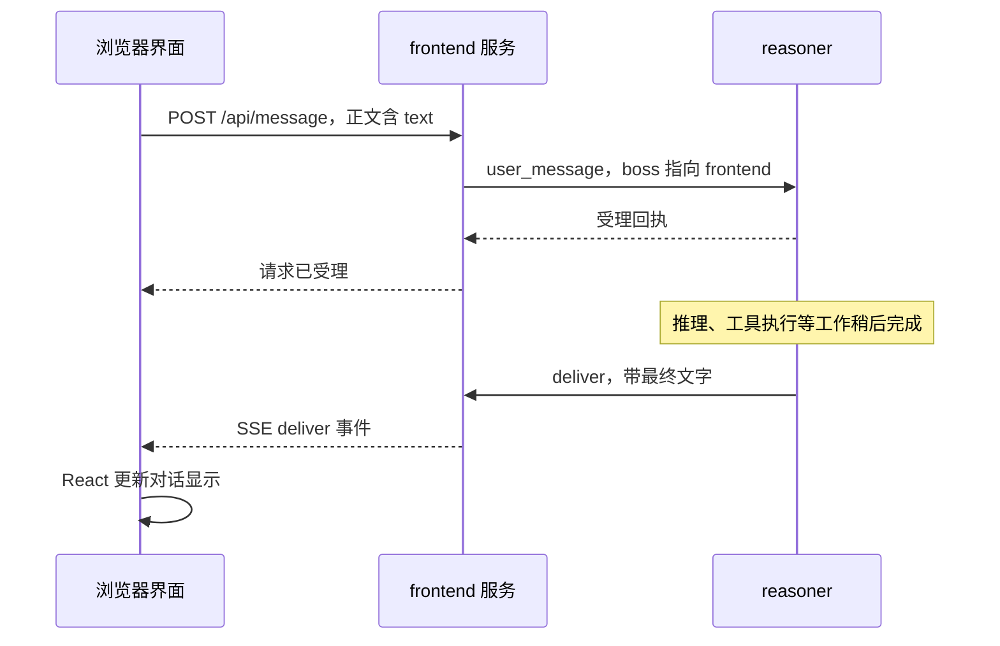

# 07 前端：一个按钮怎样变成服务调用

固定源码：`149451db`。本章静态核查实际 TypeScript 代码；操作结果是教学预期，本轮没有打开并验收整套页面。

## 1. 先把“前端”拆成两件事

你看到的网页，是浏览器运行的界面。SUMP 的 `frontend` 目录还包含一个 Node.js 程序，它负责向 SUMP 服务发消息。

想象餐厅：菜单和按钮是桌上的点餐屏；接单柜台把订单交给厨房。点餐屏并不自己炒菜。

| 技术 | 白话解释 | 在本项目中的工作 |
| --- | --- | --- |
| TypeScript | 给 JavaScript 加上可检查的数据类型 | 减少传错字段、用错值的错误 |
| React | 把页面拆成可组合部件 | 对话、设置行、任务列表、待审批区 |
| Node.js | 让 JavaScript 在浏览器外运行 | 前端服务进程、HTTP API、连接 SUMP |
| Vite | 把网页源码加工成浏览器可加载的文件 | 构建 `dist/web` |
| HTTP API | 浏览器向服务器发请求的约定 | 发消息、查设置、提交裁决 |
| SSE | 服务器不断向网页推送事件的连接 | 新回复、设置状态、审批和进度 |

SSE 全称 Server-Sent Events，可以理解为“服务端不断播报变化”。它主要是服务端向浏览器单向推送。浏览器要提交操作，仍用 HTTP 请求。它不等于 SUMP 内部使用的 WebSocket。

源码入口：[package.json](https://github.com/NouSart/sump/blob/149451dbf9ec953006da7c1926c336cfd9da0633/frontend/package.json)、[服务入口](https://github.com/NouSart/sump/blob/149451dbf9ec953006da7c1926c336cfd9da0633/frontend/src/server/index.ts)、[网页入口](https://github.com/NouSart/sump/blob/149451dbf9ec953006da7c1926c336cfd9da0633/frontend/src/web/main.tsx)。

## 2. 一次发送消息的完整路径

以下是假设用户输入“你好”的流程模拟，不是这次运行日志。

**受理回执**就是“柜台收到了订单”。它不保证模型已经回答，也不保证所有工具执行成功。

`boss` 指向谁，决定这条链面向谁交付。门户代表用户接收答复，所以它把自己设为交付对象。`boss` 是路由关系，不能代替登录身份或权限凭据。

现有网页门户使用固定会话 `web:private:owner`。这表示当前是单用户门户，不能由此宣称已有任意多用户隔离。

对应代码：[浏览器请求函数](https://github.com/NouSart/sump/blob/149451dbf9ec953006da7c1926c336cfd9da0633/frontend/src/web/api.ts)、[HTTP 路由](https://github.com/NouSart/sump/blob/149451dbf9ec953006da7c1926c336cfd9da0633/frontend/src/server/api.ts)、[门户身份与事件](https://github.com/NouSart/sump/blob/149451dbf9ec953006da7c1926c336cfd9da0633/frontend/src/server/portal.ts)。

## 3. 设置页面为什么会显示“待确认”

设置中心接受修改，与目标服务应用修改，是两个时间点。

可以把它想成改快递地址：你提交了新地址，不等于配送员的设备已经同步。页面必须区分这两个事实，否则用户会把“保存成功”误认为“已经生效”。

普通设置、秘密设置、只读设置的保存方式也不同：

- 普通设置可以有默认值和用户覆盖值，中心保存覆盖。
- 秘密设置只展示“是否已设置”；值交给消费它的服务保存，不把明文作为普通配置返回。
- 只读设置用于展示启动时的事实，例如监听地址；修改它通常需要换启动参数并重启。

“不回显”只说明页面不会直接展示秘密，不代表落盘文件已经加密。密钥文件仍需按秘密管理。

源码：[SettingsPanel](https://github.com/NouSart/sump/blob/149451dbf9ec953006da7c1926c336cfd9da0633/frontend/src/web/components/SettingsPanel.tsx)、[设置 API](https://github.com/NouSart/sump/blob/149451dbf9ec953006da7c1926c336cfd9da0633/frontend/src/server/api.ts)。

## 4. 审批按钮不等于网页在判断命令安全

页面只展示待审项，再把用户的选择送给 approval。真正的待审状态、有效期和命令约束归 approval。

实际路线是：`ApprovalStrip` 调用网页 API → `POST /api/approvals` → frontend 调用原生 `approval_decide` → approval 检查并处理。

这里有两个易混点：

1. 页面上的“批准执行”是对一条待审命令的选择，不是永久允许所有同名命令。
2. 页面显示提交成功，也不等于命令已经执行完；执行结果仍要沿工具结果通路返回。

代码里的按钮没有“总是允许”。不要为方便测试把“单次批准”改成隐式修改全局白名单。

源码：[ApprovalStrip](https://github.com/NouSart/sump/blob/149451dbf9ec953006da7c1926c336cfd9da0633/frontend/src/web/components/ApprovalStrip.tsx)、[decideApproval](https://github.com/NouSart/sump/blob/149451dbf9ec953006da7c1926c336cfd9da0633/frontend/src/web/api.ts)。

## 5. Host 和 Origin 各回答什么

**Host** 是请求打算访问的主机名称和端口。**Origin** 是浏览器说明“这次请求来自哪个网站”的信息。

当前门户会检查这些信息，阻止不受信地址和跨站页面借用本地入口。这里的信任栅栏不是多用户登录系统。知道一个服务名、或者把 `from` 写成某个名字，也不会自然获得可靠身份。

这解释了为什么默认本地使用的页面不能直接改成公网监听后就认为准备好了。公网接入还要独立处理认证、授权、部署与隔离。

源码：[门户访问检查](https://github.com/NouSart/sump/blob/149451dbf9ec953006da7c1926c336cfd9da0633/frontend/src/server/portal.ts)。

## 6. 不运行命令也能做的阅读练习

1. 用编辑器打开源码根目录。
2. 打开 `frontend/src/web/api.ts`，查找 `sendMessage`。
3. 找到它使用的 `/api/message`。
4. 打开 `frontend/src/server/api.ts`，查找相同路径。
5. 找到 `user_message`，观察它交给哪个后端服务。

预期成果：你能画出“网页函数 → HTTP 路由 → SUMP 动作”的三格图。这里没有要求你运行模型，也不需要密钥。

如果找不到函数，先按路径或动作名查；不要仅凭文件名猜实现。浏览器 API 的字段是 JSON，服务内部的实际信封仍是 MessagePack。

## 7. 有运行环境时的观察练习

前提：你已经按 [第 09 课](09-从源码到可复现验证.md) 准备隔离学习副本，并用项目已有启动方式运行。不要为了观察设置页开启公网。

1. 浏览器打开 `http://127.0.0.1:9501`，确认是自己的本地服务。
2. 进入设置页，看名册中哪些服务在线。
3. 选择 `mcp`，找到只读监听地址和 `http.token` 秘密项。
4. 本练习只观察；不复制或展示真实 token，不需要修改设置。
5. 如果已经配置了模型，可以发送普通问候，观察受理与最终回答分两次出现。

如果只有页面却没有模型答复，不必先重装前端。依次看中心是否连接、reasoner 是否在线、模型是否配置、最终交付是否报错。页面加载、服务发现、模型调用、结果交付是四个独立环节。

## 8. 小测与答案

问：网页能打开，是否证明系统可调用模型？

答：不能，网页文件可以被正常托管，但 reasoner 或模型配置仍可能不可用。

问：`deliver` 返回成功，是否证明用户已经读过？

答：不能，它是系统交付层的确认，不是人的阅读确认。
