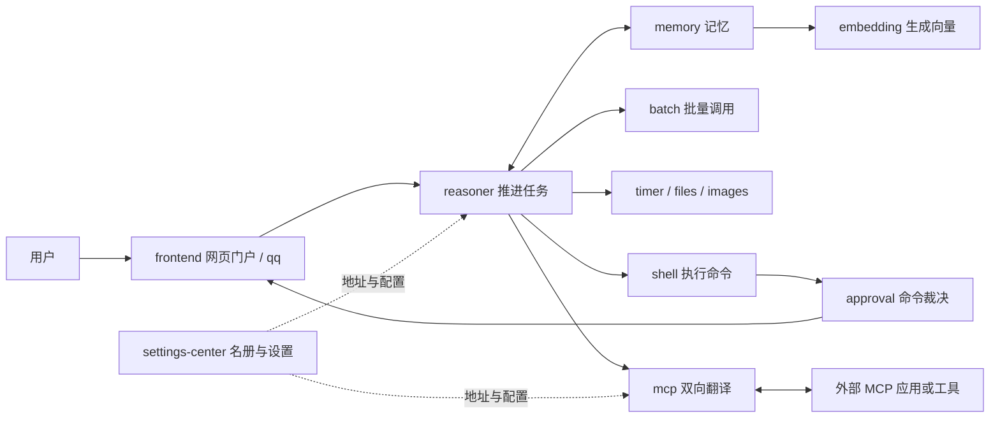

# SUMP 核心技术：从零读到一条完整调用链

校订完成日期：2026-10-28。

版本：2026-10-26，主线提交 `149451dbf9ec953006da7c1926c336cfd9da0633`。这是 PR #20 合并后的源码。这里的“当前”只指这个固定版本，日后主线继续变化时另建版本笔记。

本轮是源码阅读与知识整理，没有重新执行整个项目，也没有新增功能。课堂里的消息、时间线和页面结果，除非单独注明证据，都是帮助理解的模拟。

## 今天只学一件事

先回答：“SUMP 为什么要拆成多个服务？”

答案不是为了把一个程序切得越碎越好，而是让能力有自己的负责人、运行过程和数据边界。每个服务只承诺自己的输入输出。别人可以替换它，也可以通过明确的消息调用它，不必知道它内部如何存数据。

这与“简洁、可组合、自定义强”的方向一致。需要一个小助手时可以只启用必要能力；不是一开始就建设插件商店、发行版平台或统一管理所有任务的巨型服务。

## 阅读顺序

| 课 | 学完能回答什么 | 前置知识 |
| --- | --- | --- |
| [01 Go 与独立服务](01-Go与独立服务.md) | 源码、包、模块、进程和并发分别是什么？ | 会打开文件 |
| [02 WebSocket 与消息协议](02-WebSocket与消息协议.md) | 两个程序怎样准确地交换一封消息？ | 第 01 课 |
| [03 注册发现与配置](03-注册发现与配置.md) | 如何找到服务，配置谁保存，故障谁负责？ | 第 02 课 |
| [04 模型工具与异步任务](04-模型工具与异步任务.md) | 模型如何提出调用，结果晚到怎么办？ | 第 02、03 课 |
| [05 SQLite 记忆与向量检索](05-SQLite记忆与向量检索.md) | 记忆如何存、怎么找、检索失败怎么办？ | 先理解服务有自己的数据 |
| [06 批处理与并发边界](06-批处理与并发边界.md) | 多个任务怎样一起推进，又不混淆结果？ | 第 04 课 |
| [07 前端与可视化操作](07-前端与可视化操作.md) | 一个按钮如何变成后端消息？ | 第 02、04 课 |
| [08 MCP、审批与注入边界](08-MCP审批与内容边界.md) | 翻译、批准执行和识别恶意内容为什么分开？ | 第 04、07 课 |
| [09 从源码到可复现验证](09-从源码到可复现验证.md) | 怎样从零拿到正确版本，判断是否真能工作？ | 可以先只做阅读练习 |
| [10 术语与知识地图](10-术语与知识地图.md) | 新词之间是什么关系，应该先学哪个？ | 随用随查 |

每课分三种动作：**读**是看懂；**想**是在纸上模拟；**做**才是运行。你可以先完成全部“读”和“想”，不需要一直开 PowerShell。

## 一张总图

箭头表示调用或交付关系，不表示所有能力都能绕过权限直接调用。省略了多数注册线，避免把图画成线团。`protocol` 和 `service` 是共享代码库，不另画成运行服务。

## 三种容易混淆的“编号”

- 主项目 README 里的 M1/M2 是主项目自己的历史阶段。
- 旧 MCP 笔记里的 M1/M2 是 MCP 的实现阶段。
- 本课程的 01/02 是学习顺序，不是开发里程碑。

学习时优先认提交哈希。哈希是 Git 对一次提交的标识，例如本页的 `149451db…`，比“最新那份”准确。

版本差异与证据见 [本次版本记录](../../版本记录/2026-10-26-主线149451db/README.md)。没有把旧笔记覆盖成新状态。
